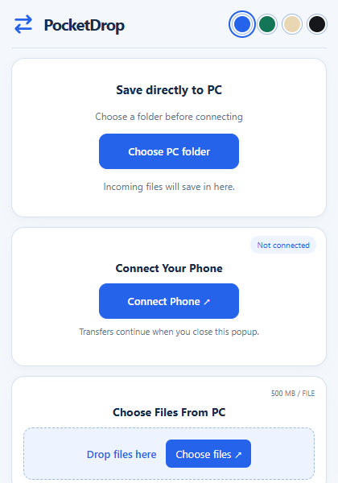
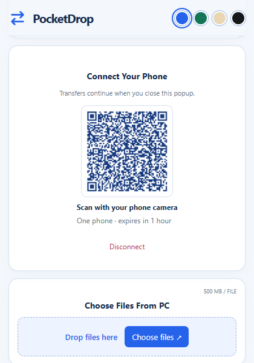
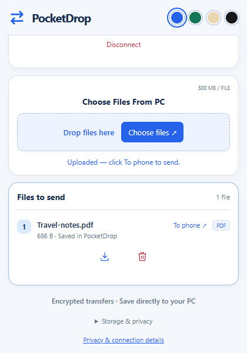

  
  <h1>PocketDrop</h1>
  
<strong>Private file transfers between your phone and computer.</strong>

  
Scan a QR code, choose your files, and send them directly between your devices—without uploading them to PocketDrop cloud storage.

  

    <a href="https://tasnimrimi.github.io/PocketDrop-Website/"><strong>Visit the website</strong></a>
    ·
    <a href="https://chromewebstore.google.com/detail/ancoaipejlinofhccakcealheckdgfdm"><strong>Add to Chrome</strong></a>
  

---

## How it works

1. Choose a destination folder on your computer.
2. Generate a private QR code in the PocketDrop extension.
3. Scan it with your phone and connect.
4. Send files in either direction.

Files sent from your phone save directly into the computer folder you selected. To send something to your phone, choose it in the extension and select **To phone**.

<table>
  <tr>
    <td align="center"></td>
    <td align="center"></td>
    <td align="center"></td>
  </tr>
  <tr>
    <td align="center"><strong>1. Choose a folder</strong></td>
    <td align="center"><strong>2. Scan and connect</strong></td>
    <td align="center"><strong>3. Send your files</strong></td>
  </tr>
</table>

## Features

### Free

- Encrypted phone-to-computer and computer-to-phone transfers
- Files up to 500 MB each
- Direct saving into a folder chosen by the user
- No account or mobile app required
- No PocketDrop cloud file storage
- Transfers continue when the extension popup closes
- Blue, green, reading, and black themes

### PocketDrop Pro

- Everything in the Free plan
- Files up to 10 GB each
- Direct peer-to-peer (P2P) transfers between two computers
- Connections across different Wi-Fi networks where direct WebRTC is available
- Resume interrupted transfers during the same active pairing
- Private recovery key for restoring access
- One-time payment with no monthly subscription

Mobile-network support is planned for a future update.

## Privacy by design

PocketDrop uses encrypted WebRTC connections so file contents travel directly between the paired devices. PeerJS and Google STUN help establish the connection, but PocketDrop does not upload transferred files to its website, payment service, or licensing service.

Some restricted workplace, school, guest, VPN, or carrier networks may block direct connections. Keep Chrome running and leave the phone transfer page open until the transfer finishes.

- [Privacy Policy](https://tasnimrimi.github.io/PocketDrop-Website/privacy.html)
- [Privacy & Connection Details](https://tasnimrimi.github.io/PocketDrop-Website/phone/privacy.html)
- [Terms of Service](https://tasnimrimi.github.io/PocketDrop-Website/terms.html)
- [Refund Policy](https://tasnimrimi.github.io/PocketDrop-Website/refund.html)

## About this repository

This repository contains the public PocketDrop product website, checkout interface, legal pages, and deployed phone companion. The private extension and licensing-service source are maintained separately.

## Support

Found a problem or have a question?

- [Open an issue](https://github.com/tasnimrimi/PocketDrop-Website/issues)
- Email [tasnim454247734@gmail.com](mailto:tasnim454247734@gmail.com)

Please do not include private files, recovery keys, payment details, or active pairing codes in a public issue.

---

  Developed by <strong>Tasnim Akhter</strong>

